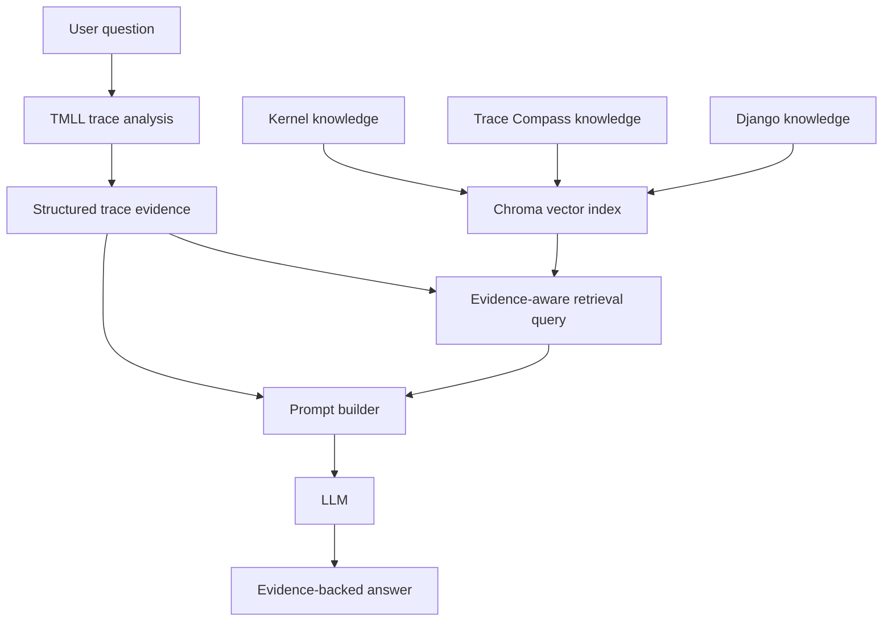

# Building a RAG Assistant for TMLL

This guide implements the first version of a retrieval-augmented generation (RAG) layer for TMLL. It is intentionally focused on Django-related Linux kernel traces and three knowledge domains:

1. Linux kernel tracing
2. Trace Compass and TMLL
3. Django

The central design rule is:

> TMLL provides authoritative facts from the currently opened trace. The RAG index stores documentation that helps explain those facts.

Do **not** embed every trace event in the vector database. Query the trace through TMLL, convert the results into structured evidence, and use that evidence to retrieve relevant documentation.

## Target architecture



The first milestone uses local vector retrieval only:

- ChromaDB for persistent vector storage
- `BAAI/bge-small-en-v1.5` for local embeddings
- Markdown documents with YAML front matter
- One Markdown file as one chunk initially
- TMLL trace results kept separate from the knowledge index

BM25, reranking, source-quality weighting, and MCP integration are later milestones.

## Prerequisites

Before starting, confirm that:

- The TMLL repository is available locally.
- Its `uv` environment works.
- The TSP server can be started.
- Existing TMLL tests pass.
- The Django workload is represented by kernel trace data, even if the original Django project is unavailable.

Run all commands below from the TMLL repository root.

## Step 1: Create a branch

```bash
git switch -c feature/tmll-rag
```

This keeps the RAG work isolated from the existing TMLL implementation.

## Step 2: Install the dependencies

If the repository uses `pyproject.toml`, add the packages to the project:

```bash
uv add chromadb sentence-transformers pyyaml
```

If you only want to test the packages in the current environment without modifying project dependencies, use:

```bash
uv pip install chromadb sentence-transformers pyyaml
```

Verify the installation:

```bash
uv run python -c "import chromadb, sentence_transformers, yaml; print('RAG dependencies are available')"
```

Expected output:

```text
RAG dependencies are available
```

The embedding model is downloaded the first time it is used. Embedding generation does not require an OpenAI API key.

## Step 3: Create the package structure

Create the following directories and files inside the existing `tmll/` package:

```text
tmll/
├── rag/
│   ├── __init__.py
│   ├── config.py
│   ├── schemas.py
│   ├── index_builder.py
│   ├── retriever.py
│   ├── evidence_builder.py
│   └── prompt_builder.py
├── knowledge/
│   ├── kernel_tracing/
│   ├── trace_compass/
│   └── django/
└── rag_storage/
```

Create them with:

```bash
mkdir -p tmll/rag \
  tmll/knowledge/kernel_tracing \
  tmll/knowledge/trace_compass \
  tmll/knowledge/django \
  tmll/rag_storage

touch tmll/rag/__init__.py
touch tmll/rag/config.py
touch tmll/rag/schemas.py
touch tmll/rag/index_builder.py
touch tmll/rag/retriever.py
touch tmll/rag/evidence_builder.py
touch tmll/rag/prompt_builder.py
```

Keep RAG code out of `TMLLClient`. The client should continue to communicate with the TSP server; the RAG package consumes its analysis results.

## Step 4: Configure the RAG layer

Add the following to `tmll/rag/config.py`:

```python
from dataclasses import dataclass
from pathlib import Path


@dataclass(frozen=True)
class RAGConfig:
    knowledge_directory: Path = Path("tmll/knowledge")
    storage_directory: Path = Path("tmll/rag_storage")
    collection_name: str = "tmll_knowledge"
    embedding_model: str = "BAAI/bge-small-en-v1.5"
    default_result_limit: int = 6


DEFAULT_CONFIG = RAGConfig()
```

All paths are relative to the repository root. If RAG will be invoked from another working directory, resolve the paths relative to the installed package instead.

## Step 5: Define the shared schemas

Add the following to `tmll/rag/schemas.py`:

```python
from dataclasses import dataclass
from typing import Any


@dataclass(frozen=True)
class RetrievedDocument:
    text: str
    metadata: dict[str, Any]
    distance: float


@dataclass(frozen=True)
class TraceEvidence:
    tid: int
    process_name: str
    blocked_ms: float
    runnable_ms: float
    user_mode_ms: float
    system_call_ms: float
    dominant_blocking_syscall: str | None = None
    longest_blocked_interval_ms: float | None = None
```

The schema prevents the prompt builder from depending directly on raw TMLL dataframes.

## Step 6: Create the initial knowledge documents

Start with manually curated Markdown documents. Do not crawl large websites yet.

Recommended initial files:

```text
tmll/knowledge/
├── kernel_tracing/
│   ├── thread_states.md
│   ├── recvfrom.md
│   ├── runnable_time.md
│   ├── sched_switch.md
│   └── futex.md
├── trace_compass/
│   ├── control_flow.md
│   ├── thread_status.md
│   ├── resources_view.md
│   └── system_call_analysis.md
└── django/
    ├── request_lifecycle.md
    ├── django_socket_waits.md
    ├── database_waits.md
    └── wsgi_workers.md
```

Every document must have a unique `id`, a `title`, a `domain`, and source information.

Create `tmll/knowledge/kernel_tracing/recvfrom.md`:

```markdown
---
id: kernel-recvfrom-001
title: Blocking in recvfrom
domain: kernel_tracing
concept: recvfrom
trace_type: lttng_kernel
source_url: https://man7.org/linux/man-pages/man2/recvfrom.2.html
source_title: Linux recvfrom manual page
---

# Blocking in recvfrom

The `recvfrom` system call receives data from a socket.

For a blocking socket, the calling thread waits when no message is available.
A thread blocked inside `recvfrom` is therefore waiting for socket data, not
waiting to be scheduled on a CPU.

The system call alone does not identify the remote component. Socket or
application-level correlation is required before attributing the delay to an
HTTP client, database, cache, or another service.
```

Create `tmll/knowledge/kernel_tracing/runnable_time.md`:

```markdown
---
id: kernel-runnable-001
title: Runnable time and CPU contention
domain: kernel_tracing
concept: runnable
trace_type: lttng_kernel
source_url: https://archive.eclipse.org/tracecompass/doc/stable/org.eclipse.tracecompass.doc.user/LTTng-Kernel-Analysis.html
source_title: Trace Compass LTTng Kernel Analysis Guide
---

# Runnable time and CPU contention

A runnable thread is ready to execute but is not currently running on a CPU.
Substantial runnable time can indicate CPU contention or scheduling delay.
Low runnable time does not support CPU contention as the primary cause of a
thread's delay.
```

Create `tmll/knowledge/trace_compass/control_flow.md`:

```markdown
---
id: trace-compass-control-flow-001
title: Control Flow view
domain: trace_compass
concept: control_flow
trace_type: lttng_kernel
source_url: https://archive.eclipse.org/tracecompass/doc/stable/org.eclipse.tracecompass.doc.user/LTTng-Kernel-Analysis.html
source_title: Trace Compass LTTng Kernel Analysis Guide
---

# Control Flow view

The Control Flow view shows thread states over time. It can help determine when
a thread was running, runnable, blocked, interrupted, or executing a system
call. It is useful for inspecting the intervals surrounding a suspected delay.

The view does not independently identify the application-level request or the
remote endpoint associated with a socket.
```

Create `tmll/knowledge/django/django_socket_waits.md`:

```markdown
---
id: django-socket-waits-001
title: Socket waits in a Django deployment
domain: django
concept: socket_wait
documentation_version: "5.2"
trace_application_version: unknown
source_url: https://docs.djangoproject.com/en/5.2/
source_title: Django 5.2 documentation
---

# Socket waits in a Django deployment

A Python process participating in a Django deployment may use sockets to
communicate with an HTTP client, reverse proxy, database, cache, or another
service. A kernel trace showing a wait in `recvfrom` confirms a socket-data wait
but does not, by itself, identify which Django dependency owns that socket.

The original Django version for the traced `django-vote` workload is unknown.
This document uses Django 5.2 documentation only as a reference for stable,
general concepts.
```

Use authoritative sources when adding more documents:

- Linux manual pages and kernel documentation for system calls and scheduler behaviour
- The Trace Compass LTTng Kernel Analysis guide and TMLL documentation for analyses and outputs
- Django 5.2 documentation for request handling, WSGI/ASGI, middleware, ORM, cache, and deployment concepts

Do not index secrets, passwords, environment-variable values, or production connection strings.

## Step 7: Implement the vector index

Add the following to `tmll/rag/index_builder.py`:

```python
from pathlib import Path
from typing import Any

import chromadb
import yaml
from sentence_transformers import SentenceTransformer

from tmll.rag.config import DEFAULT_CONFIG, RAGConfig


class KnowledgeIndex:
    def __init__(self, config: RAGConfig = DEFAULT_CONFIG):
        self.config = config
        self.model = SentenceTransformer(config.embedding_model)
        self.client = chromadb.PersistentClient(
            path=str(config.storage_directory)
        )
        self.collection = self.client.get_or_create_collection(
            name=config.collection_name,
            metadata={"hnsw:space": "cosine"},
        )

    @staticmethod
    def _read_markdown(path: Path) -> tuple[dict[str, Any], str]:
        contents = path.read_text(encoding="utf-8")
        if not contents.startswith("---"):
            raise ValueError(f"Missing YAML front matter: {path}")

        parts = contents.split("---", maxsplit=2)
        if len(parts) != 3:
            raise ValueError(f"Invalid YAML front matter: {path}")

        metadata = yaml.safe_load(parts[1])
        text = parts[2].strip()

        required = {"id", "title", "domain", "source_url", "source_title"}
        missing = required.difference(metadata)
        if missing:
            raise ValueError(f"Missing {sorted(missing)} in {path}")

        return metadata, text

    def add_markdown(self, path: Path) -> None:
        metadata, text = self._read_markdown(path)
        document = (
            f"Title: {metadata['title']}\n"
            f"Domain: {metadata['domain']}\n\n"
            f"{text}"
        )
        embedding = self.model.encode(
            document,
            normalize_embeddings=True,
        ).tolist()

        self.collection.upsert(
            ids=[str(metadata["id"])],
            documents=[document],
            metadatas=[metadata],
            embeddings=[embedding],
        )

    def build(self, knowledge_directory: Path | None = None) -> int:
        directory = knowledge_directory or self.config.knowledge_directory
        paths = sorted(directory.rglob("*.md"))
        if not paths:
            raise ValueError(f"No Markdown documents found in {directory}")

        for path in paths:
            self.add_markdown(path)

        return len(paths)


if __name__ == "__main__":
    count = KnowledgeIndex().build()
    print(f"Indexed {count} knowledge documents")
```

For the first milestone, one file equals one chunk. Keep each file short and focused on one diagnostic concept.

Build the index:

```bash
uv run python -m tmll.rag.index_builder
```

Expected output after adding the four example files:

```text
Indexed 4 knowledge documents
```

Running the command again is safe because `upsert` updates documents with the same IDs rather than duplicating them.

## Step 8: Implement retrieval

Add the following to `tmll/rag/retriever.py`:

```python
from tmll.rag.config import DEFAULT_CONFIG, RAGConfig
from tmll.rag.index_builder import KnowledgeIndex
from tmll.rag.schemas import RetrievedDocument


class KnowledgeRetriever:
    QUERY_PREFIX = "Represent this sentence for searching relevant passages: "

    def __init__(
        self,
        index: KnowledgeIndex | None = None,
        config: RAGConfig = DEFAULT_CONFIG,
    ):
        self.index = index or KnowledgeIndex(config)
        self.config = config

    def search(
        self,
        query: str,
        domain: str | None = None,
        limit: int | None = None,
    ) -> list[RetrievedDocument]:
        query_text = f"{self.QUERY_PREFIX}{query.strip()}"
        embedding = self.index.model.encode(
            query_text,
            normalize_embeddings=True,
        ).tolist()

        query_arguments = {
            "query_embeddings": [embedding],
            "n_results": limit or self.config.default_result_limit,
        }
        if domain is not None:
            query_arguments["where"] = {"domain": domain}

        results = self.index.collection.query(**query_arguments)
        documents = results.get("documents", [[]])[0]
        metadatas = results.get("metadatas", [[]])[0]
        distances = results.get("distances", [[]])[0]

        return [
            RetrievedDocument(
                text=document,
                metadata=metadata,
                distance=float(distance),
            )
            for document, metadata, distance in zip(
                documents,
                metadatas,
                distances,
            )
        ]
```

The prefix is recommended for BGE retrieval queries. It is used for the query, not for stored documents.

## Step 9: Test retrieval independently

From the repository root, open a Python shell:

```bash
uv run python
```

Then run:

```python
from tmll.rag.retriever import KnowledgeRetriever

retriever = KnowledgeRetriever()
results = retriever.search(
    "Why would a Python thread block in recvfrom?",
    limit=4,
)

for rank, result in enumerate(results, start=1):
    print(rank, result.metadata["title"], result.distance)
```

The top results should include most of the following:

- `Blocking in recvfrom`
- `Socket waits in a Django deployment`
- `Runnable time and CPU contention`
- `Control Flow view`

With cosine distance, a lower distance means a closer match. Do not choose a universal distance threshold yet; first record retrieval results across the evaluation questions.

Also test filtered retrieval:

```python
results = retriever.search(
    "Which view shows when a thread was blocked?",
    domain="trace_compass",
    limit=3,
)
```

All returned documents should have `domain: trace_compass`.

## Step 10: Convert TMLL output into structured evidence

Add the following to `tmll/rag/evidence_builder.py`:

```python
from typing import Any

from tmll.rag.schemas import TraceEvidence


class EvidenceBuilder:
    @staticmethod
    def from_thread_analysis(result: dict[str, Any]) -> TraceEvidence:
        return TraceEvidence(
            tid=int(result["tid"]),
            process_name=str(result["process_name"]),
            blocked_ms=float(result["blocked_ms"]),
            runnable_ms=float(result["runnable_ms"]),
            user_mode_ms=float(result["user_mode_ms"]),
            system_call_ms=float(result["system_call_ms"]),
            dominant_blocking_syscall=result.get("dominant_blocking_syscall"),
            longest_blocked_interval_ms=result.get(
                "longest_blocked_interval_ms"
            ),
        )

    @staticmethod
    def build_retrieval_query(
        question: str,
        evidence: TraceEvidence,
    ) -> str:
        facts = [
            question,
            f"Linux kernel thread {evidence.tid} ({evidence.process_name}).",
            f"Blocked for {evidence.blocked_ms:.3f} ms.",
            f"Runnable for {evidence.runnable_ms:.3f} ms.",
        ]

        if evidence.dominant_blocking_syscall:
            facts.append(
                "Dominant blocking system call: "
                f"{evidence.dominant_blocking_syscall}."
            )

        facts.append(
            "Interpret Linux thread states, system calls, Django socket "
            "behaviour, and relevant Trace Compass views."
        )
        return "\n".join(facts)
```

Adapt `from_thread_analysis` to the exact keys produced by the existing TMLL thread-analysis code. Keep this conversion in one place so changes to raw dataframes do not spread into retrieval and prompting code.

Example evidence for the existing trace:

```python
trace_result = {
    "tid": 2327,
    "process_name": "python",
    "blocked_ms": 233.786,
    "runnable_ms": 3.536,
    "user_mode_ms": 165.298,
    "system_call_ms": 24.441,
    "dominant_blocking_syscall": "recvfrom",
    "longest_blocked_interval_ms": 30.878,
}
```

An evidence-aware query is more precise than searching only for `Why was thread 2327 slow?`, because the original question contains no reusable technical concepts.

## Step 11: Build the grounded LLM prompt

Add the following to `tmll/rag/prompt_builder.py`:

```python
from tmll.rag.schemas import RetrievedDocument, TraceEvidence


class PromptBuilder:
    @staticmethod
    def build(
        question: str,
        evidence: TraceEvidence,
        documents: list[RetrievedDocument],
    ) -> str:
        evidence_lines = [
            f"- Thread: {evidence.tid} ({evidence.process_name})",
            f"- Blocked: {evidence.blocked_ms:.3f} ms",
            f"- Runnable: {evidence.runnable_ms:.3f} ms",
            f"- User mode: {evidence.user_mode_ms:.3f} ms",
            f"- System calls: {evidence.system_call_ms:.3f} ms",
        ]

        if evidence.dominant_blocking_syscall:
            evidence_lines.append(
                "- Dominant blocking syscall: "
                f"{evidence.dominant_blocking_syscall}"
            )
        if evidence.longest_blocked_interval_ms is not None:
            evidence_lines.append(
                "- Longest blocked interval: "
                f"{evidence.longest_blocked_interval_ms:.3f} ms"
            )

        knowledge_sections = []
        for index, document in enumerate(documents, start=1):
            metadata = document.metadata
            knowledge_sections.append(
                f"[{index}] {metadata['title']}\n"
                f"{document.text}\n"
                f"Source: {metadata['source_url']}"
            )

        return f"""USER QUESTION
{question}

TRACE EVIDENCE
{chr(10).join(evidence_lines)}

RETRIEVED KNOWLEDGE
{chr(10).join(knowledge_sections)}

INSTRUCTIONS
1. Treat TRACE EVIDENCE as authoritative for this trace.
2. Use RETRIEVED KNOWLEDGE only to interpret the evidence.
3. Never change or invent trace measurements.
4. Separate confirmed trace facts from possible interpretations.
5. Do not attribute the socket to a database, cache, client, or service unless
   the trace identifies it.
6. State what additional evidence would confirm the application-level cause.
7. Recommend the next Trace Compass analysis when useful.
8. Cite relevant retrieved sources in the answer.
"""
```

This prompt makes the evidence hierarchy explicit:

1. TMLL trace measurements are facts about the current trace.
2. Retrieved documents explain how those measurements are normally interpreted.
3. Django-level causes remain hypotheses unless supported by additional correlation.

## Step 12: Run the complete RAG preparation flow

The following code connects evidence construction, retrieval, and prompt construction. It stops before the model call so the prompt can be inspected first.

```python
from tmll.rag.evidence_builder import EvidenceBuilder
from tmll.rag.prompt_builder import PromptBuilder
from tmll.rag.retriever import KnowledgeRetriever

question = "Why was thread 2327 slow?"

trace_result = {
    "tid": 2327,
    "process_name": "python",
    "blocked_ms": 233.786,
    "runnable_ms": 3.536,
    "user_mode_ms": 165.298,
    "system_call_ms": 24.441,
    "dominant_blocking_syscall": "recvfrom",
    "longest_blocked_interval_ms": 30.878,
}

evidence = EvidenceBuilder.from_thread_analysis(trace_result)
retrieval_query = EvidenceBuilder.build_retrieval_query(question, evidence)

retriever = KnowledgeRetriever()
documents = retriever.search(retrieval_query, limit=6)

prompt = PromptBuilder.build(question, evidence, documents)
print(prompt)
```

Inspect the printed prompt before sending it to ChatGPT, a local Llama model, or another LLM. The RAG components are model-independent.

## Step 13: Evaluate the first answer

For the known thread, the answer should communicate the following:

> Thread 2327 was primarily delayed while blocked in `recvfrom`, meaning it was waiting for socket data. Its low runnable time does not support CPU contention as the main cause. In a Django deployment, the socket could belong to an HTTP client, database, cache, or another service; the kernel evidence does not yet identify which one.

The answer must not claim that the database was slow unless socket or application-level evidence identifies the database connection.

Check the answer against this list:

- Does it preserve every TMLL measurement?
- Does it distinguish blocked time from runnable time?
- Does it explain `recvfrom` correctly?
- Does it label Django interpretations as possibilities?
- Does it avoid inventing a remote component?
- Does it cite the retrieved documentation?
- Does it recommend a useful next analysis?

## Step 14: Add automated tests

Create tests for indexing and retrieval before connecting an LLM.

Minimum test cases:

1. A valid Markdown file is indexed.
2. A document without YAML front matter is rejected.
3. A document missing a required metadata field is rejected.
4. Rebuilding the index does not duplicate IDs.
5. A `recvfrom` query retrieves the `recvfrom` document.
6. A Trace Compass domain filter returns only Trace Compass documents.
7. The evidence builder preserves numeric values.
8. The prompt includes the question, evidence, sources, and grounding instructions.

Run the project test suite afterward:

```bash
uv run pytest
```

## Step 15: Expand the first knowledge index

Build only enough knowledge to support the initial thread-slowness use case.

Target content:

- 15 kernel-tracing documents
- 10 Trace Compass/TMLL documents
- 10 Django documents
- 35–60 total chunks

Initial supported questions:

1. Why was thread 2327 slow?
2. Was it CPU-starved or blocked?
3. Which system call covered its blocked intervals?
4. What does `recvfrom` mean?
5. What could a socket wait mean in Django?
6. Which Trace Compass view should be inspected next?

Recommended kernel topics:

- Running, runnable, blocked, interrupted, unknown, and not-alive states
- `sched_switch`, `sched_wakeup`, and CPU migration
- `recvfrom`, `recvmsg`, `sendto`, `connect`, `accept`, `poll`, and `epoll_wait`
- `futex`, file I/O, and system-call time

Recommended Trace Compass topics:

- Control Flow
- Thread Status
- Resources
- CPU Usage
- System Call analysis
- Events Editor
- What each view can and cannot establish
- Related TSP/TMLL outputs

Recommended Django topics:

- Request lifecycle
- WSGI and ASGI workers
- Reverse proxy communication
- Database and cache connections
- External HTTP calls
- ORM performance
- Worker exhaustion
- Normal idle socket waits versus request-path delays

## Step 16: Add chunking when documents become longer

One file per chunk is sufficient for the initial curated documents. Add heading-aware chunking when documents regularly exceed about 600 tokens.

Starting chunking policy:

- 300–600 tokens per chunk
- 50–100 tokens of overlap
- Preserve the document title and parent headings in every chunk
- Never split a short syscall explanation across chunks
- Keep each symptom-to-interpretation rule together
- Give every chunk a stable ID such as `kernel-recvfrom-001-chunk-01`

Rebuild the index after changing the chunking method. If old chunk IDs are no longer valid, use a new collection name during development so stale chunks cannot appear in results.

## Step 17: Record a retrieval evaluation set

Create approximately 20 questions with expected relevant documents. Include direct, paraphrased, and ambiguous questions.

Examples:

| Question | Expected knowledge |
|---|---|
| Why was thread 2327 slow? | blocked state, `recvfrom`, runnable time |
| Was the thread waiting for a CPU? | runnable time and CPU contention |
| What does a socket receive wait mean? | `recvfrom` and Django socket waits |
| Which view shows thread states? | Control Flow or Thread Status |
| Was the database definitely slow? | limits of kernel-only socket evidence |

For each question, record:

- Whether an expected document appears in the top 3
- Whether it appears in the top 6
- The rank of the first relevant document
- Irrelevant documents retrieved
- Whether domain filtering improves the result

Do not add an LLM-based evaluator until the retrieval results can be inspected manually.

## Step 18: Add the LLM only after retrieval passes

The first end-to-end version is ready when:

- TMLL produces structured evidence for the target thread.
- The expected knowledge appears in the top retrieval results.
- The prompt clearly separates trace evidence and retrieved knowledge.
- The generated answer preserves measurements and uncertainty.
- Sources are included in the answer.

The generation model may be ChatGPT or a local model. Embedding and generation are separate choices; using local BGE embeddings does not require using a local generation model.

## Step 19: Later upgrades

After the vector-only version is reliable, add improvements in this order:

1. **Keyword/BM25 retrieval** for exact names such as `recvfrom`, `sched_switch`, and `Control Flow`.
2. **Hybrid result fusion** to combine vector and keyword rankings.
3. **Reranking** to choose the best 5–8 chunks.
4. **Source-quality weighting** to prioritize official documentation.
5. **Query planning** to decide which knowledge domains are relevant.
6. **Heading-aware chunking** for longer documents.
7. **MCP integration** with a tool such as `answer_trace_question`.
8. **Trace Compass view control** through separate MCP tools.

Do not make the RAG retriever responsible for opening views. Retrieval explains what view is useful; an MCP tool performs the Trace Compass action.

## Definition of done for milestone 1

Milestone 1 is complete when all of the following are true:

- [ ] RAG dependencies are installed and recorded in the project.
- [ ] The `tmll/rag/` package exists independently of `TMLLClient`.
- [ ] At least 35 curated knowledge documents are indexed.
- [ ] Every document contains source and domain metadata.
- [ ] Rebuilding the index does not create duplicates.
- [ ] The six initial question types retrieve relevant documents.
- [ ] TMLL evidence is represented by a typed schema.
- [ ] The retrieval query includes both the user question and trace facts.
- [ ] The prompt separates facts, knowledge, and inference.
- [ ] The answer does not overclaim a Django-level root cause.
- [ ] Retrieval and prompt-building tests pass.
- [ ] The existing TMLL test suite still passes.

## Troubleshooting

### The embedding model cannot be downloaded

The first model load requires network access. Download it on a connected machine or configure the Hugging Face cache before running in an offline environment.

### No documents are returned

Confirm that the index was built from the repository root and that `tmll/rag_storage/` contains the persistent Chroma data. Then check the collection count:

```python
from tmll.rag.index_builder import KnowledgeIndex

index = KnowledgeIndex()
print(index.collection.count())
```

### Metadata insertion fails

Keep Chroma metadata values scalar: strings, integers, floating-point values, or booleans. Represent complex lists or dictionaries as JSON strings until a dedicated metadata-normalization function is added.

### Retrieval returns Django documents for every question

Use the `domain` filter for domain-specific questions. Later, add a query planner that selects domains based on both the user question and trace evidence.

### An answer claims the database was slow

Strengthen the prompt rule that kernel socket evidence does not identify the remote endpoint. Add an evaluation question that explicitly checks this failure mode.

### Existing TMLL behaviour breaks

Verify that no RAG dependency was imported into the core `TMLLClient` path. RAG should be initialized only by the assistant or analysis layer that needs it.

## Immediate next action

Implement Steps 2–9 first. Index the four example documents and confirm that the query below retrieves `Blocking in recvfrom` near the top:

```text
Why would a Python thread block in recvfrom?
```

Only after that test passes should the TMLL evidence and LLM prompt be connected.
